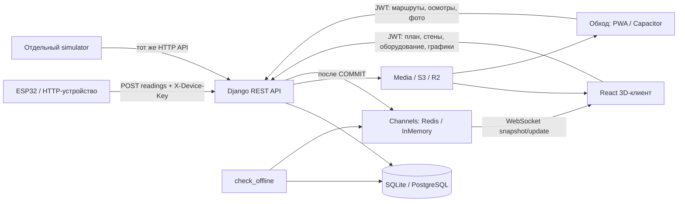

# Архитектура цифрового двойника

Ревизия рабочей копии от 05.11.2026. Документы описывают код на диске, включая незакоммиченные изменения. Сервисы и тесты при ревизии не запускались. Корень этой документации — `E:\3D_project_bakery\docs`; пути к исходникам ниже считаются от `E:\3D_project_bakery`.

## Структура

| Путь | Назначение |
|---|---|
| `plant-twin/backend/` | Django: пользователи, план, оборудование, телеметрия, обходы, административный интерфейс |
| `plant-twin/frontend-twin/` | Действующий React-интерфейс с 3D-сценой, адаптированный прототип |
| `plant-twin/mobile/` | Уже существующий клиент «Обход»: обычный JavaScript, PWA, Capacitor и Android-проект |
| `plant-twin/simulator/` | Отдельная Python-программа, отправляющая искусственную телеметрию в настоящий API; автоматически не запускается |
| `plant-twin/data/` | Локальные GLB и JSON импорта, включая `ovens_import.json`; содержимое в основном исключено из Git |
| `plant-twin/docs/` | Текущая документация, ревизия и примеры; исторические материалы — в docs/old/ |
| `plant-twin/frontend-twin/src/` | Интерфейс, сцена, API-клиент, состояние и преобразование координат |
| `plant-twin/frontend-twin/models/` | Встроенные GLB из прототипа; остаются статические импорты |
| `plant-twin/frontend-twin/tools/` | Playwright-проверки, извлечение плана из PDF, генераторы GLB |
| `plant-twin/backend/tests/` | Проверки API, ролей, миграций, телеметрии, обходов и стен |
| `plant-twin/backend/media/`, `staticfiles/` | Загруженные файлы и собранная статика; не исходный код |
| `plant-twin/.qa/` | Локальные вспомогательные материалы, исключённые из Git; не часть запуска |
| `plant-twin/docs/old/` | Архив прежнего frontend и исторических ревизий |
| `frontend-twin-before-sim-removal.zip` | Архив до удаления симулятора; содержимое при ревизии не распаковывалось |
| `package-lock.json` в корне workspace | Отдельный lock-файл; основная сборка использует package.json/lock внутри клиентов |

У `plant-twin/` есть собственный `.git`. Старый `plant-twin/frontend/` отсутствует на диске, а в индексе Git его файлы отмечены удалёнными. Это существующее состояние пользователя, не результат ревизии. Документация ревизии перенесена в `plant-twin/docs/` и включена в Git.

## Стек и версии

Версии зависимостей взяты из `backend/requirements.txt`, клиентских `package.json` и `package-lock.json`, а не из предположений о доступных релизах.

| Компонент | Версия в проекте |
|---|---|
| Python | `3.14-slim` в backend/Dockerfile; точная локальная версия не устанавливалась |
| Django / DRF | 5.2.18 / 3.16.1 |
| SimpleJWT / drf-spectacular | 5.5.1 / 0.29.0 |
| Channels / channels-redis / Daphne | 4.3.2 / 4.3.0 / 4.2.3 |
| django-cors-headers / WhiteNoise | 4.9.0 / 6.12.0 |
| django-storages / psycopg | 1.14.6 / 3.3.6 |
| pytest / pytest-django | 9.1.1 / 4.14.0 |
| React / Three.js | lock: 19.3.1 / 0.186.1 |
| React Three Fiber / Drei / Zustand | package.json: ^9.8.2 / ^10.7.9 / ^5.0.16 |
| Vite / TypeScript / Vitest, 3D-клиент | lock: 8.3.5 / 7.0.2 / 5.1.0 |
| Recharts / idb | package.json: ^3.10.1 / ^8.0.4; реально используются графиком и кэшем стен |
| Vite / Vitest, mobile | lock: 7.3.7 / 3.2.7 |
| Capacitor core/android/cli | 8.5.3; app 8.1.2; camera ^8.2.6 |
| Node | mobile/Dockerfile: 22-alpine; Vite требует ^20.19.0 или >=22.12.0, Vitest 3D-клиента — ^22.12.0, ^24.0.0 или >=26.0.0 |
| База | SQLite по умолчанию, PostgreSQL через DATABASE_URL; версия PostgreSQL не закреплена |
| Redis | Для Channels в production; версия сервера не закреплена |

## Как части связаны

Прошивка ESP32 в просмотренном дереве не найдена. Сейчас доказан HTTP-приём устройств. MQTT/S7/OPC UA/Modbus перечислены в модели Signal, но работающие сборщики для них не найдены: `backend/collectors/` — заглушка.

Бэкенд — источник плана, координат станков, статусов, состояний, обходов, стен и загруженных моделей. `status` вычисляется из телеметрии, `condition` задаётся людьми. Они не взаимозаменяемы.

3D-клиент получает `/plan/`, затем `/ws/v1/live/`. Историю измерений запрашивает отдельно. Пол, оси, помещения и исходные стены также берутся из встроенного `domain/plant-layout.json`: сцена ещё зависит от конкретного чертежа. Стены можно сохранить на сервере, но текущий интерфейс выбирает только первую видимую зону.

Мобильный клиент уже получает маршруты, чек-листы, карточки и историю. Осмотры с фото хранятся в IndexedDB до отправки, UUID защищает от повторного создания. Обновление чужих осмотров — HTTP-опрос, в `mobile/src/main.js` WebSocket-подключения нет.

Запись состояния/телеметрии публикует события после транзакции. Redis нужен, чтобы отдельные процессы видели общую очередь; InMemory работает только внутри одного процесса. Celery и отдельный брокер заданий не найдены.

Далее: [бэкенд](BACKEND.md), [API](API.md), [фронтенд](FRONTEND.md), [запуск](SETUP.md), [ревизия](AUDIT.md).
