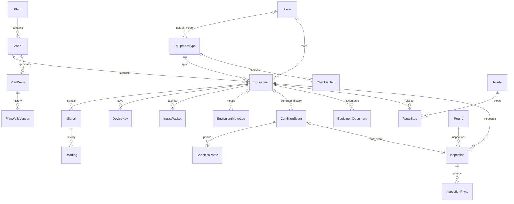

# Бэкенд

Пути в этом документе относительно `plant-twin/backend/`. Источники: `config/settings.py`, `config/urls.py`, модели и сервисы приложений. API-контракт — в [API.md](API.md).

## Приложения

| Приложение | Ответственность |
|---|---|
| `accounts` | Вход и refresh JWT, профиль, права по Django Groups; собственных моделей нет |
| `plants` | Заводы, зоны, план, координатная привязка, версии стен и колонн |
| `equipment` | Типы, GLB, оборудование, сигналы, ключи устройств, измерения, техническое состояние, документы, фото, WebSocket |
| `rounds` | Чек-листы по типу, маршруты, шаги, ежедневные обходы и осмотры |
| `config` | Settings, маршрутизация, ASGI/WSGI, health, единый формат ошибок |
| `tickets`, `climate`, `control`, `collectors`, `notifications` | Каталоги с README-заглушками; в INSTALLED_APPS не включены, реализации API не найдено |

Дополнительно включены стандартные Django auth/admin/sessions и blacklist SimpleJWT. Django admin управляет справочниками, паспортами, документами, сигналами и ключами: не всё вынесено в REST.

## Модели и поля

У всех моделей неявный `id: BigAutoField`. Ниже перечислены собственные поля; FK — внешний ключ, `?` — NULL допустим, JSON — JSONField. Текстовые поля с `blank=True` обычно возвращают пустую строку, а не NULL. Полная валидация — в `plants/validators.py`, `plants/walls.py`, `equipment/validators.py` и сервисах.

### plants/models.py

| Модель | Поля и назначение |
|---|---|
| Plant | `code: str(80), unique`, `name: str(200)` — предприятие |
| Zone | `plant: FK Plant CASCADE`, `code: str(80)`, `name: str(200)`, `model_file: File` GLB до 50 МБ; `size_x?, size_z?: float` > 0; `offset_x, offset_z, rotation_deg, model_rotation_deg: float`; `plan_offset_x, plan_offset_z, plan_rotation_deg: float`; `order: int=0`, `visible_by_default: bool=true`. Уникальна пара plant/code |
| PlanWalls | `zone: OneToOne Zone CASCADE`, `data: JSON`, `version: positive int=0`, `updated_by?: FK User SET_NULL`, `updated_at: datetime auto_now` — текущая геометрия |
| PlanWallsVersion | `plan_walls: FK CASCADE`, `version: positive int`, `data: JSON`, `updated_by?: FK User SET_NULL`, `updated_at: datetime auto_now_add`. Уникальна пара plan_walls/version, хранятся последние 20 версий |

Координаты — метры. `rotation_deg` — поворот зоны, `model_rotation_deg` исправляет только GLB. `plan_offset_*` и `plan_rotation_deg` привязывают зону к чертежу нового фронтенда. Клиент преобразует северный +Z плана в −Z Three.js.

### equipment/models.py

| Модель | Поля и назначение |
|---|---|
| Asset | `code: slug(80), unique`, `name: str(200)`, `glb_file: File` до 20 МБ; `led_node_name: str(200)='led'`, `animation_node_name: str(200)`, `rotation_speed_deg_s: float=0`; `size_x/y/z: float=1`, строго положительные; `updated_at` |
| EquipmentType | `code: slug(80), unique`, `name: str(200)`, `default_asset?: FK Asset SET_NULL`, `signal_templates: JSON list`, `key_signals: JSON list`, `status_rules: JSON dict`, `offline_seconds?: positive int` |
| Equipment | `code: slug(80), unique`, `name: str(200)`, `kind: enum(machine, room, valve, conveyor, other)`, `subtype: str(80)`; `zone: FK Zone PROTECT`, `type: FK EquipmentType PROTECT`, `asset?: FK Asset SET_NULL`; `size_w/d/h: float=1`; `pos_x/y/z, rotation_deg: float=0`; `device_id?: str(200), unique`, `is_active: bool=true`; `status: enum`, `last_seen?`, `status_changed_at?`; `condition: enum`, `condition_changed_at?`; паспорт `manufacturer, model_name: str(200)`, `serial_number, inventory_number: str(100)`, `commissioned_on?: date`, `service_contact: str(300)`, `notes: text`; `image: File`, `image_source: render/photo/пусто`, `image_updated_at?`; `created`, `updated` |
| Signal | `equipment: FK CASCADE`, `key: slug(80)`, `device_key: str(80)`, `name: str(200)`, `kind: state/number/bool`, `unit: str(30)`, `value_type: bool/float/int`, `source: http/mqtt/s7/opcua/modbus/manual/пусто`, `source_address: str(500)`; `min_value?, max_value?, nominal_value?: float`; `offline_after_seconds: positive int=10`; `last_value?: float`, `last_seen?: datetime`, `last_text: str(64)`, `sensor_fault: bool=false`, `last_reading_at?: datetime`. Уникальны equipment/key |
| Reading | `signal: FK CASCADE`, `ts: datetime`, `value?: float`, `value_text: str(64)`, `sensor_fault: bool=false`, `source: str(20)`, `received_at: auto_now_add`; индекс signal/ts |
| IngestPacket | `equipment: FK CASCADE`, `seq?: bigint`, `ts`, `received_at`; уникальны equipment/seq при заданном seq, иначе equipment/ts. Дедупликация пакетов |
| DeviceKey | `equipment: FK CASCADE`, `name: str(200)`, `prefix: str(12)`, `key_hash: str(64), unique`, `created_at`, `last_used_at?`, `revoked_at?`. Секрет хранится как SHA-256, открытый ключ показывается при выпуске |
| EquipmentMoveLog | `equipment: FK CASCADE`, `actor?: FK User SET_NULL`, `created_at`, `old_values, new_values: JSON`. API пишет изменения X/Z/поворота |
| ConditionEvent | `equipment: FK CASCADE`, `previous: condition/пусто`, `condition: enum`, `comment: text до 2000`, `source: manual/round/maintenance`, `actor?: FK User SET_NULL`, `created_at` |
| ConditionPhoto | `event: FK ConditionEvent CASCADE`, `file: File` до 10 МБ, `created_at` |
| EquipmentDocument | `equipment: FK CASCADE`, `title: str(200)`, `file: File` до 50 МБ, `uploaded_at` |

`status`: `run`, `stop`, `alarm`, `offline`, `unknown`. `condition`: `working`, `idle`, `faulty`, `maintenance`, `repair`, `decommissioned`. Изменять их обычным PATCH оборудования нельзя.

При сохранении Equipment пустой device_id превращается в NULL; `ensure_signals()` создаёт недостающие сигналы из шаблона типа. Старые сигналы при смене типа автоматически не удаляются. `effective_asset` выбирает явный asset или default_asset типа. Фото осмотров/состояний допускают jpg/jpeg/png/webp/heic/heif, основная картинка оборудования — jpg/jpeg/png/webp.

### rounds/models.py

| Модель | Поля и назначение |
|---|---|
| ChecklistItem | `equipment_type: FK CASCADE`, `order: positive int=0`, `text: str(300)`, `is_active: bool=true` |
| Route | `name: str(120)`, `is_active: bool=true`, `order: positive int=0`, `updated_at` |
| RouteStop | `route: FK CASCADE`, `equipment: FK CASCADE`, `position: positive int=0`; уникальны route/equipment |
| Round | `date: date, unique`, `created_at`. Один общий обход на дату, не на человека или маршрут |
| Inspection | `round: FK CASCADE`, `equipment: FK CASCADE`, `inspector?: FK auth.User SET_NULL`, `client_id: UUID unique`, `inspected_at: datetime`, `received_at: datetime`, `result: ok/remark/fault`, `answers: JSON list`, `comment: text до 2000`, `condition_event?: OneToOne ConditionEvent SET_NULL`; индекс equipment/inspected_at |
| InspectionPhoto | `inspection: FK CASCADE`, `file: File` до 10 МБ |

## Авторизация и роли

Стандартная модель Django User, группы с точными именами `operator`, `engineer`, `admin` (`accounts/services.py:6`). Роли руководителя/manager нет. `is_staff` открывает admin при наличии Django-разрешений и добавляет device_id в выдачу плана, но само по себе не даёт производственных прав API. Активный superuser проходит все ролевые проверки, даже если `/auth/me/` возвращает пустой roles.

| Роль | Права REST |
|---|---|
| Любой вошедший | Собственный профиль |
| operator, engineer, admin | Чтение плана, стен, оборудования, измерений, маршрутов и осмотров |
| engineer, admin | Смена технического состояния/картинки, запись осмотров, правка маршрутов и стен |
| admin | Создание, изменение и удаление оборудования, включая расстановку |

JWT access по умолчанию 15 минут, refresh 7 дней; refresh ротируется и старый заносится в blacklist. Клиент обязан сохранить оба новых токена. Серверного logout в URLconf нет. Объектного разграничения по заводу/маршруту/владельцу не найдено.

## Телеметрия и фоновые операции

`equipment/telemetry_views.py` проверяет X-Device-Key, затем `ingest.py` проверяет формат, устройство, сигналы, время и дубли. Приём ограничен 500 записями за пакет и возрастом 7 суток; будущее допускается до 5 минут. Время в API — Unix-секунды.

Reading записывается при изменении значения/качества либо после READING_MIN_INTERVAL_SECONDS. Старые пакеты пополняют историю, но не должны откатывать текущие значения. Расчёт status идёт по `EquipmentType.status_rules`: alarm_if, state-сигнал, run_if, иначе unknown. Таймаут — от типа либо STATUS_OFFLINE_SECONDS. `Signal.offline_after_seconds` в этом расчёте не применяется.

`python manage.py check_offline --loop 15` обновляет offline и очищает старые IngestPacket. В `start.sh` запускается рядом с Daphne; в Windows нужно отдельное окно. Очистка Reading и планировщик ППР не найдены. `health/` проверяет только ответ HTTP, не БД/Redis.

Обход создаётся первым осмотром дня. `fault` переводит working/idle в faulty, для других состояний оставляет отметку. Запоздалый осмотр не отменяет более позднюю смену состояния. `ok` автоматически не означает ремонт и не возвращает faulty в working. Источник maintenance у ConditionEvent существует, но полноценный модуль ТО не реализован.

## Изменения 06.11.2026

DELETE equipment архивирует (is_active=false), PATCH is_active=true восстанавливает. История и RouteStop не удаляются; выдача маршрутов фильтрует архивные станки. Физическое удаление через admin разрешено лишь без Reading/Inspection/ConditionEvent, включая массовое действие.

Plan/card/WS используют effective_status и передают last_seen + offline_seconds; WS ts сохранён. rounds/serializers.py валидирует вход осмотра до записи, сохраняя мобильный multipart и числовые строки времени в JSON. EquipmentWriteSerializer проверяет итоговую позицию при создании, перемещении и смене зоны. Модели обходов и миграции не менялись.
